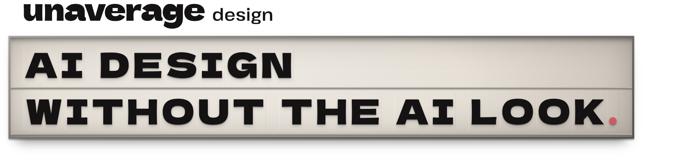

<picture>
  <source media="(prefers-color-scheme: dark)" srcset="docs/images/readme-header-dark.png">
  
</picture>

# unaverage design: KI-Design ohne KI-Look

Design-Skill für Claude, Claude Code und Codex, der Ergebnisse auf Studio-Niveau anstrebt statt des generischen KI-Looks, für Websites, Produkt-UI, Decks, Social Posts, Anzeigen und Marke. Gebaut und getestet in Claude Code; er läuft auch in der Claude-App und in Codex. Dieses Repository ist der Marktplatz der unaverage-Skills; `unaverage-design` ist sein erster Skill.

[English](README.md) | Deutsch

Ein Skill ist ein Ordner mit Anweisungen, Referenzdateien und kleinen Skripten, den dein Coding-Agent lädt, wenn eine Aufgabe ihn braucht.

```sh
npx skills add jakob-meyer/unaverage --skill unaverage-design -g -a claude-code -a codex
```

Danach eine visuelle Aufgabe beschreiben oder `/unaverage-design` in Claude Code oder `$unaverage-design` in Codex aufrufen. Weitere Wege: [Installation](#installation).


<sub>Testergebnis, kein Kundenprojekt: Die Firma ist erfunden. Gebaut mit unaverage-design 3.4.2 und Claude Opus 5.5 in einem Lauf mit simulierter Nutzerin. Die Tafeln von Étienne Trouvelot und ein NASA-Foto kamen mit dem Auftrag; keine generierten Bilder. [Nachweise](docs/images/credits.md).</sub>

## Das Problem

Generisches KI-Design entsteht nicht aus schlechtem Geschmack, sondern aus dem statistischen Mittelwert: dieselben Schriften, Verläufe, Kartenraster und Heldenbereiche, weil sie am wahrscheinlichsten sind. Starke Gestaltung unterscheidet sich davon vor allem in einem Punkt: Jedes prägende Element stammt nachweislich aus dem Gegenstand (Produkt, Name, Material, Daten, Menschen), und genau eine Idee trägt das Ganze, während das Gerüst vertraut bleibt.

unaverage-design macht daraus einen Ablauf mit dir im Loop: verstehen, Aufwand vereinbaren, nach Dingen aus deiner Welt fragen, Richtungen mit Rangfolge als Mockups zeigen, im Zielmedium bauen, messen, von KI-Subagenten im frischen Kontext prüfen lassen, die beste Fassung liefern. Bei kleinen Aufgaben bleibt er so leicht wie ein Handwerks-Check.

## So arbeitet der Skill

- **Eine greifbare Idee aus der Welt des Produkts.** Der Skill sucht für jede Arbeit eine Bildidee aus einem Objekt, einer Situation oder einem konkreten Beispiel aus der Welt des Produkts, etwa das Röstprotokoll einer Kaffeerösterei oder der Frachtbrief einer Spedition. Ein konkretes Beispiel zieht sich als roter Faden durch alle Flächen. Abstrakte Formen und reine Typografie begleiten die Idee, sie ersetzen sie nicht.
- **Erst deine Dinge.** Ist die Richtung offen, das Ziel klar und hast du noch keine Dinge genannt, aus denen der Look kommen soll, fragt die erste Nachricht, statt vorzuschlagen: was eure Kunden heute in der Hand oder vor Augen haben, ein oder zwei Dinge, deren Aussehen du magst, von überall, was du in eurer Branche nicht mehr sehen kannst, was du jemandem sagst, der zögert, und was nicht versprochen werden darf oder gesagt werden muss. Fragen nach Dingen und Gegensatzpaare kommen ohne vorgeschlagene Antwort, damit deine Worte deine bleiben. Bei unklarem Ziel kommen bis zu drei Zielfragen dazu. Eine kleine Aufgabe startet sofort, mit höchstens zwei Fragen, und eine Richtung, die du selbst vorgibst, wird in die Arbeit übersetzt, nicht neu verhandelt.
- **Drei Richtungen mit Rangfolge.** Die Richtungen folgen aus deinen Antworten und kommen als Mockups. Hast du schon mindestens zwei Dinge genannt, aus denen der Look kommen soll, und ist das Ziel klar, oder willst du sofort Richtungen, stehen die drei Richtungen stattdessen in der ersten Nachricht. In beiden Fällen liegen sie in drei Abständen: nah an der Kategorie (in Bestform, nie als generischer Standard), an der Grenze des Gewohnten und mutig. Jede bekommt einen Namen aus deinem Projekt, was du siehst, warum sie zu euch passt und ihr Risiko. Die Empfehlung steht zuerst, mit Begründung, und eine eigene Idee in einem Satz geht immer. Die Richtungen stammen aus einem Katalog von 13 Stilrichtungen und werden nach Medium, Ziel, Zielgruppe, Material und Marke gereiht. Eine Richtung, für die Material fehlt, wird nie empfohlen, und du erfährst, was sie wieder nach oben bringt.
- **Aufwandsstufen, vorher vereinbart.** Schnell, Standard oder Studio, genannt wie ein Angebot: Richtungen und Mockups, Prüfer, Runden, grobe Dauer. Der Skill hält sich daran und benennt jeden Zusatz, bevor er ihn macht.
- **Mockups zur Wahl.** In Standard und Studio siehst du dieselbe Schlüsselfläche in jeder Richtung, mit gleichem Inhalt und gleicher Reife, nebeneinander. Die Mockups unterscheiden sich auf mindestens zwei von fünf Ebenen (Ankertyp, Typo-Stimme, Dichte, Farbstrategie, Signaturmoment), nicht nur in der Farbe, und mindestens eines zeigt ein Ding, das du genannt hast, falls du eines genannt hast. Du wählst, mischst entlang von Systemebenen, verlangst "sicherer" oder "mutiger" oder bringst eine eigene Idee. Hat der Skill zuerst gefragt, kommt ein Gegensatzpaar wie "Was wäre schlimmer: zu ruhig oder zu laut?" mit den Mockups, wenn du siehst, was es bedeutet.
- **Bau im Zielmedium.** Seiten, Produkt-Screens, Folien, Posts, Dokumente und Logos entstehen als HTML, CSS und SVG in der echten Größe des Mediums und werden als Bild gerendert. Jede Runde wird gesichert, ausgeliefert wird die am stärksten bewertete Fassung, nicht die letzte. Jeder Fix nach der letzten Prüfung wird als ungeprüft benannt.
- **Gemessen und von frischen KI-Agenten geprüft.** Nach jedem Render prüfen blockierende Gates Kontrast nach WCAG 2.2 AA, horizontalen Überlauf bei 320 px, Mindestschrift je Medium, Exportmaße und Wahrheit (nichts Erfundenes als echt ausgegeben). Danach beurteilen KI-Subagenten im frischen Kontext, die einen Art Director und eine Person aus der Zielgruppe spielen, die Bilder gegen einen einseitigen Designvertrag. In den Tests liefen sie auf demselben Modell wie der Bauende. Sie sehen keinen Code und keine seiner Begründungen, und Paarvergleiche laufen immer in beiden Reihenfolgen.
- **Generik-Check.** Ein Skript rendert das Ergebnis und zählt Signaturen generischen KI-Designs, zum Beispiel Icons aus Icon-Bibliotheken als Bild, Verlaufstext, farbige Glows, Kartenraster und Vorlagen-Schriftstapel. Ein generisches Element wird durch etwas aus der Welt des Produkts mit derselben Aufgabe ersetzt, nicht einfach gestrichen. Der Index misst Nähe zu Vorlagen, nicht Eigenständigkeit, deshalb bleibt die Sichtprüfung Pflicht.
- **Ehrlicher Inhalt.** Nichts Erfundenes wird als echt ausgegeben: Zahlen, Kunden, Logos, Zitate oder Personen. Beispielwerte können vorkommen, etwa ein Beispielangebot im Preisabschnitt, und sind als erfunden gekennzeichnet. Produktoberflächen werden aus den Funktionen im Auftrag gebaut, mit stimmigen Beispieldaten. Fehlendes Material bekommt einen ehrlichen Stellvertreter oder einen gestalteten Platz in der Form des fertigen Inhalts. Die Präsentationsansicht bleibt sauber; eine eigene Liste offener Punkte nennt Stellvertreter, Entwurfstexte und offene Punkte.

Die Lehre aus den deutschen Tests: Verbote und Prüfungen allein machen Ergebnisse sauber, aber leer. Gegen die eigenen älteren Versionen gewirkt hat die Reihenfolge: erst Idee und Material, dann System, dann Filter. Die englischen Tests zeigen, dass diese Reihenfolge allein nicht reicht; siehe [Testergebnisse](#testergebnisse).

Neben dem Bauen kennt der Skill drei Modi: **Korrektur** verbessert ein bestehendes Design, behält seine Richtung und zeigt Vorher und Nachher. **Nur prüfen** beantwortet Fragen wie "wirkt das generisch?" mit einem gemessenen Schnellcheck und drei konkreten Änderungen, ohne etwas zu bauen. **Autonom** ("einfach machen") entscheidet selbst bis zur Stufe Standard und nennt am Ende alle Annahmen.

## Formate

| Bereich | Formate |
|---|---|
| Web und Stores | Websites, Landingpages (B2B, B2C, Onlineshop), Preisseiten, Kampagnen-Microsites, App-Store-Screenshots, Marktplatz-Listings |
| Produkt-UI | Web-Apps, Dashboards, Mobile Apps, Onboarding, Zustände (leer, laden, Fehler, Erfolg, Überlauf), Einstellungen, Formulare und Checkout, Design-Systeme, KI-Chat- und Agenten-Oberflächen, Doku und Changelogs |
| Decks und Dokumente | Pitch Decks, Investor Updates, Sales Decks, interne Präsentationen, Angebote, Keynotes, One-Pager, Reports, Whitepaper, Case Studies, Infografiken, Newsletter, transaktionale E-Mails |
| Social und Anzeigen | Social Posts (B2B und B2C), Carousels und LinkedIn-Dokumente, LinkedIn-, Meta- und Display-Anzeigen, YouTube-Thumbnails, TikTok- und Reel-Cover, Blog-Header und OG-Bilder, Webinar- und Event-Visuals, Share-Cards |
| Marke | Logos und Wortmarken, erster Markenauftritt, Refresh einer Marke, Employer Branding, Geschäftsausstattung, Launch-Kits, Pressekits, Vorlagen-Kits für Dritte |
| Print und Raum | Flyer, Plakate und Außenwerbung, Visitenkarten, Verpackungen, Merch, Messestände und Rollups |

Jedes Format hat ein Profil mit Maßen, sicheren Bereichen, Mindestschrift, dem typischen KI-Fehler und einem Startset an Richtungen. Lokalisierte Varianten für mehrere Sprachen oder Märkte sind ein eigener Fall.

In der deutschen Vorgängerlinie (9. und 10. Oktober 2026, Claude Opus 5.5) wurden sieben dieser Formate und der Modus Korrektur blind getestet. Version 3.4.0 wurde auf zwei Landingpages und einer Web-App gemessen, dazu auf einem Sales Deck als Schadensprobe (30. und 31. Oktober 2026, Claude Opus 5.5). Social Posts, Carousels und Markenarbeit wurden nie mit 3.4 gemessen; ihre Zahlen stammen aus den Versionen 3.0 bis 3.2. Die übrigen Formate nutzen denselben Ablauf und ihre Profile, wurden aber nicht eigens getestet. Siehe [Testergebnisse](#testergebnisse).

Deine Marke geht vor: Marken-, CI- und Format-Skills haben Vorrang bei Farben, Schriften und Logo, unaverage-design wirkt dann über Anker, Komposition, Bildsprache, Dichte und Copy. Exportformate wie PowerPoint-Dateien sind Sache eines Format-Skills.

## Sprachen

Der Skill ist auf Englisch geschrieben und arbeitet auf Englisch und Deutsch. Das Ergebnis folgt der Sprache deines Auftrags, und Rückfragen stellt der Skill in der Sprache, in der du schreibst.

Was je Markt gilt, steht in Modulen in `references/markets/`. Das deutsche Marktmodul deckt deutsche Copy ab (Du oder Sie, Anglizismen), Typografie (Komposita, Umbruch, Anführungszeichen, Schweizer Schreibweise, Zahlenformate) und deutsche Wortlisten für den Generik-Check. Ein zweites Modul enthält Checklisten zu EU- und DACH-Recht: Barrierefreiheitsstärkungsgesetz (BFSG), Preisangabenverordnung (PAngV), Gesetz gegen den unlauteren Wettbewerb (UWG), Impressum, Schriften und DSGVO. Weitere Märkte sind willkommen, als Issue oder Pull Request.

## Eine Sitzung in Kürze

Du bittest um eine Landingpage für ein Kaffee-Abo und nennst nichts, woraus der Look kommen soll. Der Skill liest zuerst deinen Projektordner und schickt dann eine gebündelte Nachricht (gekürzt, zur Veranschaulichung):

```text
Verstanden: eine Landingpage für euer Kaffee-Abo, für Leute, die zu Hause
brühen. Ziel: Abschlüsse.

Aufwand: Standard (empfohlen). Drei Richtungen als Mockups des Heldenbereichs,
zwei KI-Prüfer, höchstens zwei Korrekturrunden, etwa 30 bis 60 Minuten.

Fünf kurze Fragen, bevor ich Richtungen vorschlage, weil eure Antworten sie
prägen. Ein paar Worte genügen, und "keine Ahnung" ist eine gute Antwort.
1. Was haben eure Kunden rund um eine Lieferung heute in der Hand oder vor
   Augen, zum Beispiel eine Karte, ein Etikett oder einen Zettel im Paket?
2. Nenne ein oder zwei Dinge, deren Aussehen du magst, von überall, nicht nur
   Websites.
3. Was könnt ihr in eurer Branche nicht mehr sehen?
4. Was sagst du jemandem, der zögert, mit deinen Worten?
5. Was darf ich nicht versprechen oder zeigen, und was muss gesagt werden?

Ich nehme an, korrigier mich, wenn es nicht stimmt: Ihr röstet selbst und
protokolliert jede Charge, noch keine Fotos, Farbe aus eurer Welt, und die
Bilder baue ich selbst.
```

Du antwortest in ein paar Worten: Jede Tüte trägt eine gestempelte Röstkarte, und du magst alte Apothekenetiketten. Jedes genannte Ding fließt in die Rangfolge ein. Ohne Antworten kommen die Richtungen aus dem Auftrag und deiner Branche, und der Skill sagt das. Die nächste Nachricht bringt drei Mockups desselben Heldenbereichs nebeneinander, mit Rangfolge (gekürzt, zur Veranschaulichung):

```text
A Die Röstkarte, empfohlen. Grenze des Gewohnten.
  Du siehst: die gestempelte Karte als Heldenbild, darauf die Röstkurve jedes
  Kaffees, Packpapierbraun mit einem Röstrot.
  Verlangt von dir: einen Scan einer Karte.
B Am Tresen. Nah an der Kategorie.
  Du siehst: Menschen beim Brühen zu Hause im Tageslicht, weiche Formen.
  Verlangt von dir: echte Fotos; mit ihnen rückt sie nach oben.
C Das Apothekenregal. Mutig.
  Du siehst: jeder Kaffee als Glas mit gestochenem Etikett, auf einem langen
  Regal.
  Verlangt von dir: dass die Seite eher nach Regal wirkt als nach Shop.

Aus euren Antworten: Die Röstkarte trägt A, das Apothekenetikett trägt C.

Was wäre schlimmer: zu kalt oder zu gemütlich? Ohne Antwort bleibt die
Dosierung mittel.

Wähle eine, mische, sag "keine, sicherer" oder "keine, mutiger", oder bring
deine eigene Idee.
```

Hast du schon mindestens zwei Dinge genannt, aus denen der Look kommen soll, und ist das Ziel klar, oder willst du sofort Richtungen, stehen die drei Richtungen stattdessen in der ersten Nachricht.

Danach:

1. Du wählst, mischst oder verlangst "sicherer" oder "mutiger".
2. Der Skill baut die Seite, rendert sie bei 1440, 768, 390 und 320 px und lässt nach jedem Render Gates und Generik-Check laufen.
3. Zwei KI-Subagenten, die einen Art Director und eine Person aus der Zielgruppe spielen, prüfen die Bilder im frischen Kontext. Jeder wichtige Mangel wird umgesetzt oder begründet, in höchstens zwei Runden.
4. Du bekommst die Seite, was geprüft wurde mit Ergebnis und was ungeprüft blieb, Bild- und Schriftquellen mit Lizenz und eine Liste offener Punkte mit Stellvertretern, Entwurfstexten und offenen Punkten.

## So holst du am meisten heraus

Eine Zeile reicht zum Start. Deutlich besser wird es, je mehr du selbst einbringst:

- **Beantworte die ersten Fragen.** Nenne Dinge statt Stile: was eure Kunden in der Hand haben, etwas, dessen Aussehen du magst, was du in deiner Branche nicht mehr sehen kannst. "Weiß nicht" ist eine gute Antwort.
- **Schick eigenes Material.** Fotos von Ort, Produkt oder Team, Screenshots, echte Zahlen. Handyfotos reichen. Nur du hast sie, und sie zeigen, was du wirklich anbietest.
- **Reagiere auf die Mockups.** Sag, was du zuerst siehst, was stört und was fehlt. Mische zwei Richtungen oder verlange "sicherer" oder "mutiger".
- **Verlange eine weitere Runde,** wenn noch etwas nicht stimmt. Der Skill sagt dir, was sie kostet.

Ohne Antworten baut er trotzdem, aus deinem Auftrag und deiner Branche, und sagt das.

## Aufwandsstufen

| | Schnell | Standard | Studio |
|---|---|---|---|
| Gedacht für | Einzelstück mit kurzer Lebensdauer, Marke und Inhalt stehen | Website, Kampagne, UI, Dokument; Richtung offen oder teilweise | Identität, Pitch mit hohem Einsatz, neues Produkt-UI, Marke ohne Vorgaben |
| Fragen | 0 bis 2 | 3 bis 5 | 5 bis 8, plus Discovery |
| Richtungen, die du siehst | 1, Herleitung im Abschluss | 3 Mockups mit Rangfolge (Top 3 in der ersten Nachricht, wenn du Dinge genannt hast und das Ziel klar ist oder du sie verlangst) | 3 bis 4 Mockups mit Rangfolge (Top 3 in der ersten Nachricht, wenn du Dinge genannt hast und das Ziel klar ist oder du sie verlangst), zwei Ausarbeitungen des Schlüsselstücks im Blindvergleich |
| Prüfer | Art-Director-Kurzprüfung (wenn Subagenten verfügbar) | Art Director, Zielgruppe | Art Director, Zielgruppe, Generik, Produktion und Zugang |
| Prüferaufrufe höchstens | 1 | 3 | 10 |
| Runden | 1 Korrektur | höchstens 2 | höchstens 2 je Stufe |
| Dauer, grob | 5 bis 15 Minuten | 30 bis 60 Minuten | 1,5 bis 3 Stunden |

Die Dauer ist die eigene Schätzung des Skills, keine Messung. In Runde 3.4 dauerten Standard-Bauten etwa 1,5 bis 2 Stunden auf einem Laptop, mit einer simulierten Nutzerin, die sofort antwortete; sieh die Angaben also als Untergrenze. Sagst du nichts, gilt Standard; Studio braucht ein ausdrückliches Ja. Wörter wie "schnell" oder "mal eben" führen zu Schnell, "Varianten" oder "Richtungen zur Auswahl" mindestens zu Standard. Gibst du die Richtung selbst vor, gibt es keine Richtungs-Mockups.

## Installation

Ein Skill für Englisch und Deutsch, eine Sprachauswahl gibt es nicht.

Mit der `skills`-CLI (braucht Node 22.20 oder neuer):

```sh
# Claude Code und Codex, für alle Projekte
npx skills add jakob-meyer/unaverage --skill unaverage-design -g -a claude-code -a codex

# nur für das aktuelle Projekt
npx skills add jakob-meyer/unaverage --skill unaverage-design -a claude-code -a codex
```

`npx skills add jakob-meyer/unaverage --skill unaverage-design` ohne `-a` fragt die Agenten ab.

Als Claude-Code-Plugin, in der Sitzung:

```text
/plugin marketplace add jakob-meyer/unaverage
/plugin install unaverage-design@unaverage
```

In der Shell: `claude plugin marketplace add jakob-meyer/unaverage`, dann `claude plugin install unaverage-design@unaverage`.

Manuell: `unaverage-design-<version>.zip` von der [Release-Seite](https://github.com/jakob-meyer/unaverage/releases) laden und entpacken.

```sh
unzip unaverage-design-<version>.zip -d ~/.claude/skills/   # Claude Code
unzip unaverage-design-<version>.zip -d ~/.agents/skills/   # Codex
```

Für ein einzelnes Projekt nach `.claude/skills/` oder `.agents/skills/` im Projekt entpacken.

In der Claude-App: `unaverage-design-3.4.3.zip` von der [Release-Seite](https://github.com/jakob-meyer/unaverage/releases) laden, die Codeausführung einschalten (in der englischen Oberfläche Settings, Capabilities, Create and edit files) und das ZIP als Skill hochladen, wie im [Hilfe-Center von Anthropic](https://support.claude.com/en/articles/12512180-using-skills-in-claude) beschrieben. In einem Chat ohne Projektordner den Skill in der Anfrage beim Namen nennen, zum Beispiel "Nutze dafür den Skill unaverage-design: ...".

### Aufruf

Beschreib die Aufgabe, und der Agent lädt den Skill, sobald etwas Visuelles entsteht oder geprüft wird. Direkter Aufruf:

| Installiert mit | Claude Code | Codex |
|---|---|---|
| `skills`-CLI oder ZIP | `/unaverage-design` | `$unaverage-design` |
| Claude-Code-Plugin | `/unaverage-design:unaverage-design` | |

Codex liest Skills aus `~/.agents/skills/` und erkennt neue meist selbst, sonst neu starten. Der ältere Ort `~/.codex/skills/` funktioniert noch, gilt aber als veraltet. In der ChatGPT-App läuft er im Modus Work, sobald er für Codex installiert ist (`-a codex` oben).

### Aktualisieren und entfernen

- `skills`-CLI: `npx skills update unaverage-design` und `npx skills remove unaverage-design`, mit `-g` für eine globale Installation.
- Claude-Code-Plugin: `claude plugin update unaverage-design@unaverage` oder Auto-Update unter `/plugin`, Marketplaces einschalten (für Marktplätze außerhalb von Anthropic standardmäßig aus). Entfernen mit `claude plugin uninstall unaverage-design@unaverage`; `claude plugin marketplace remove unaverage` entfernt auch den Marktplatz.
- Manuell: Ordner ersetzen oder löschen.

Die `skills`-CLI ([vercel-labs/skills](https://github.com/vercel-labs/skills)) ist ein Werkzeug eines Dritten. Sie sendet anonyme Nutzungsdaten; mit `DISABLE_TELEMETRY=1` lässt sich das abschalten, zum Beispiel:

```sh
DISABLE_TELEMETRY=1 npx skills add jakob-meyer/unaverage --skill unaverage-design -g -a claude-code -a codex
```

## Voraussetzungen

unaverage-design ist so geschrieben, dass er auch ohne Zusatzwerkzeuge funktioniert; dieser Weg wurde nur teilweise getestet. Zum Rendern, Messen und für den automatischen Generik-Check nutzt er Node 22.12 oder neuer, ein lokales Chrome, Chromium, Edge oder Brave sowie Python 3 mit Pillow und NumPy. Die App, in der der Agent läuft, muss Node finden: Unter Windows klappte ein Node im System-PATH, fnm ohne installierte Node-Version und ohne Einrichtung in der Shell gab dem Agenten keines. Nach der Installation von Node diese App neu starten. Beim ersten Einsatz und erneut nach `npx skills update`, das den Skill-Ordner ersetzt, weist der Skill den Agenten an, `npm install` im Skill-Ordner anzubieten und es nur mit deinem OK auszuführen; das installiert `puppeteer-core` und seine Abhängigkeiten (25 Pakete im Lockfile), keinen Browser. npm meldet dabei "3 high severity vulnerabilities": Alle drei stammen aus einem Paket, `zod`, das über `puppeteer-core` kommt, und die Skripte nutzen `puppeteer-core` nur, um den lokalen Browser zu steuern. Eine Korrektur ist für die nächste Version geplant. Neuere Versionen von Claude Code installieren `puppeteer-core` selbst, wenn sie das Plugin installieren oder aktualisieren (getestet mit 2.1.317); bei älteren gilt die Anweisung oben. Den Browser finden die Skripte an den üblichen Orten, sonst `CHROME_PATH` setzen. Ein optionaler Freisteller braucht macOS 14 oder neuer mit `swiftc`.

Die Skripte lesen lokale Dateien und steuern einen lokalen Browser; in der Claude-App liegen beide im Cloud-Arbeitsbereich der App. Ins Netz gehen sie nur beim Rendern einer URL, wenn eine Seite Webfonts oder andere Inhalte aus dem Netz lädt, oder für den optionalen Schriftcheck.

unaverage-design hat keinen Hersteller-Server und keine Telemetrie, er läuft komplett lokal, außer in der Claude-App, wo er im eigenen Cloud-Arbeitsbereich der App läuft. Die `skills`-CLI ist ein eigenes Werkzeug eines Dritten, siehe [Aktualisieren und entfernen](#aktualisieren-und-entfernen).

| Deine Umgebung | Was du bekommst |
|---|---|
| Shell, Node, Chrome, Python und Subagenten | den vollen Ablauf mit Messung und unabhängigen Prüfern |
| ohne Subagenten | Prüfer per Ersatz: ein separater frischer Lauf, geführte Fragen an dich oder ein kalter Selbstdurchgang, ausdrücklich als schwächstes Signal benannt |
| einzelne Werkzeuge fehlen (Node, Chrome, Python) | der Skill ist so geschrieben, dass er sagt, was fehlt und was das kostet, den Installationsbefehl anbietet (läuft nur mit deinem OK) oder einen Ersatz wie Rendern mit dem, was die Umgebung bietet, und den Generik-Check als Sichtprüfung, und im Abschluss jede Prüfung nennt, die nicht gelaufen ist; dieser Weg wurde nur teilweise getestet |
| ohne Shell, etwa ein Chat ohne Codeausführung | keine Messung, Mockups nebeneinander in einem Artifact, Ergebnisse als "ungeprüft am Bild" gekennzeichnet |

Auf Stufe Schnell nannten die Agenten in den Tests vom 16. November 2026 fehlende Werkzeuge und `npm install` oft erst im Abschluss oder gar nicht statt vor dem Bauen, und in einem Lauf auf Stufe Schnell in der Claude-App führte der Agent `npm install` ohne Rückfrage im Cloud-Arbeitsbereich der App aus.

unaverage-design führt einen Dialog mit dir und nutzt unabhängige Prüfer. Er braucht deshalb je Ergebnis mehr Zeit und Tokens als Skills, die in einem Durchgang bauen. In der einzigen englischen Testrunde mit beiden Stufen (Version 3.0, Claude Opus 5.5, 16. Oktober 2026) brauchte ein Studio-Lauf etwa das Doppelte der Tokens eines Standard-Laufs.

Gebaut und getestet in Claude Code: Alle gemessenen Skill-Läufe nutzten Claude Opus 5.5, GPT-6.1-Sol war dort nur Juror. In Codex unter macOS lief der Skill am 14. November 2026 zweimal (Version 3.4.3, GPT-6.1-Sol, Stufe Schnell, ein Plakat und ein Social Post, ohne Bewertung): Er lud aus `.agents/skills`, löste einmal ohne Nennung aus, baute beide Ergebnisse und nannte die Prüfungen, die nicht gelaufen sind. In der Standard-Sandbox von Codex startet Chrome nicht; Rendern und der gemessene Generik-Check brauchen dort deine Erlaubnis, außerhalb der Sandbox zu laufen (mit 3.4.3 noch nicht getestet).

Unter Windows 11 lief der Skill am 16. November 2026 (Version 3.4.3, Stufe Schnell, je ein Social Post, ohne Bewertung) in Claude Code in der Desktop-App (Claude Opus 5.5) und in der ChatGPT-App, die lokal mit ihrer Codex-Laufzeit arbeitete (GPT-6.1-Sol), installiert aus dem Release-ZIP nach `~/.claude/skills` und `~/.agents/skills`. In beiden löste er ohne Nennung aus und baute den Post. Nach `npm install`, das in einer zweiten Runde auf Wunsch lief, ließen beide Agenten den Generik-Check und das Messskript laufen; direkt in PowerShell aufgerufen, renderten die Skripte außerdem eine Seite und exportierten ein PDF mit Node 26.13.1 und Chrome. Windows hatte kein Python installiert: In Claude Code meldete der Generik-Check seine Pixelprüfung als nicht gelaufen, ChatGPT nutzte das Python seiner eigenen Laufzeit.

In der Claude-App (Desktop-App unter macOS, Claude Opus 5.5) wurde das Release-ZIP am 16. November 2026 als Skill hochgeladen (Version 3.4.3, ohne Bewertung). Seine Skripte liefen im Cloud-Arbeitsbereich der App, der Node, Chrome und Python hatte, Google Fonts aber nicht erreichte; der Schriftcheck lief deshalb nicht. In einem Chat mit Projektordner löste der Skill von selbst aus und lief auf Stufe Standard für eine Website, mit drei Richtungen als Mockups, dem Bau und zwei unabhängigen Prüfern. In einem Chat ohne Projektordner löste er nur aus, wenn man ihn beim Namen nannte, und baute auf Stufe Schnell ein Plakat, ließ aber seinen Prüfer und das Messskript aus.

In der ChatGPT-App unter macOS, am selben Tag und mit dem Skill als privatem Plugin, löste der Modus Work (GPT-6.1-Sol) ihn ohne Nennung aus und baute ein A4-Plakat als PDF mit Python, ohne die Skripte des Skills. Im Modus Chat (GPT-6) erzeugte die App stattdessen ein Bild, auch als der Skill beim Namen genannt war; dort funktioniert der Skill also nicht. In Codex und ChatGPT baut er oft ohne seine Messskripte. Keiner dieser Läufe wurde bewertet, und über die Qualität sagt keiner etwas.

Der Skill führt je Marke ein Richtungs-Log als `design-log.json` im Projektordner und, wenn beschreibbar, in `~/.unaverage/`. Es hält eine Marke über Sitzungen hinweg konstant und sorgt über Marken hinweg für Abwechslung bei Richtungen und Schriften.

## Testergebnisse

unaverage-design wurde gegen Blindtests entwickelt. KI-Agenten haben gebaut, die Nutzer gespielt (in einem Test antwortete der Autor selbst) und geurteilt; hinter diesen Zahlen steht kein menschlicher Juror und kein echter Nutzer. Hier die Kurzfassung; Methode, die Zahlen und die Grenzen stehen in [docs/testing.md](docs/testing.md) (auf Englisch).

**Aktuelle Fassung.** unaverage-design 3.4 fragt zuerst und zeigt Richtungen danach. In einer Runde am 30. und 31. Oktober 2026 (geprüfte Version 3.4.0) erfüllte sie eine vorab festgelegte Regel gegen die eigene Vorversion, auf drei Web- und Produktaufträgen: eine Web-App für Essensplanung (EN6), die Landingpage eines Wärmepumpen-Installateurs (EN7) und die Landingpage eines Barbershops (EN9). Ein Lauf je Auftrag, eine simulierte Nutzerin, drei KI-Jurymodelle (zwei Claude-Modelle und GPT-6.1-Sol). Die gemessene Änderung betrug +0,52 Punkte auf einer Zehn-Punkte-Skala, gefordert waren mindestens +0,36. Sie kommt überwiegend aus einem Auftrag: Der Barbershop trägt 74 Prozent, ohne ihn liegt die Änderung bei +0,20. Die beiden Versionen standen nie im selben Paar; [docs/testing.md](docs/testing.md) erklärt, wie die Änderung gemessen wurde. Auf einem Sales Deck (EN10) zeigte die Runde keinen großen Schaden, mehr nicht.

**Claude ohne Skill.** Im fairen Vergleich vom 30. und 31. Oktober 2026 (drei KI-Jurymodelle, simulierte Nutzer) lag Claude Opus 5.5 ohne Skill mit demselben Hintergrund vorab auf drei von vier Aufträgen vorn, und wir behaupten nicht, es zu schlagen; die Zahlen stehen in [docs/testing.md](docs/testing.md). Beide Seiten hatten dort die Angaben der simulierten Nutzer, Opus 5.5 im Prompt und der Skill über seine Fragen; gemessen wurden also die Seiten, nicht der Wert des Fragens. Auch mit dem ganzen Hintergrund, bevor er Richtungen bildete, blieb der Skill zurück ([docs/testing.md](docs/testing.md), Abschnitt 2.9), und auch die Webseiten von Opus 5.5 bestanden den Generik-Check. In einem Test aus einer Zeile am 7. November 2026 (Version 3.4.3), in dem der Autor die Fragen als Inhaber eines erfundenen Friseursalons beantwortete, war die Seite des Skills die am wenigsten generische von dreien: Generik-Index 0, gegen 5 bei Claude allein und 3 bei Claude allein mit denselben Antworten als Text, ohne die Wahl des Autors unter den Mockups und ohne den Layoutwunsch. Für zwei blinde KI-Jurymodelle, beide Claude-Modelle, sah sie in allen vier Rangfolgen am wenigsten nach Standard-KI aus. Der Skill nutzt denselben Check beim Bauen, und ein Lauf je Weg ist ein Beispiel ([docs/testing.md](docs/testing.md), Abschnitt 2.13).

**Sprachtest.** Am 16. Oktober 2026 bestand Version 3.0 mit ihrem deutschen Marktmodul den Sprachtest gegen die eingefrorene deutsche Fassung 2.5.2 auf drei deutschen Aufträgen, beim Carousel knapp; ein deutscher Bau mit 3.4 ist nicht gemessen.

**Deutsche Vorgängerlinie.** Diese Ergebnisse stammen aus der deutschen Vorgängerfassung des Skills, die vor der Veröffentlichung design-craft hieß (Versionen 2.3 bis 2.5), mit deutschen Aufträgen und deutschsprachigen simulierten Nutzern, am 9. und 10. Oktober 2026. Sie sind die Geschichte des Skills, keine Ergebnisse der aktuellen Fassung.

- **Gegen die Vorgängerversion v1** (Version 1.2, nicht Teil dieses Repos), auf acht Aufträgen (sieben Formate und der Modus Korrektur), je Auftrag die zuletzt getestete Version: keine Niederlage, sechs Siege, zwei Gleichstände. Fünf der sechs Siege hielten bei beiden Juroren in beiden Reihenfolgen; die Landingpage gewann bei der Zielgruppe, beim Creative Director war das Urteil geteilt.
- **Auf drei Aufträgen, die beim Bau des Skills nie verwendet wurden:** zwei Siege, ein Gleichstand.
- **Eigenständigkeit** lag auf allen acht Aufträgen über v1, der KI-Look war auf allen acht gleich oder geringer. Klarer war v1 noch auf vier davon.

Die Juroren sahen nur die gerenderten Bilder und den Auftrag, ohne zu wissen, welche Version was erzeugt hatte: ein Creative Director und eine Person aus der Zielgruppe, jeweils in beiden Reihenfolgen, dazu ein eigener Juror für den KI-Look.

**Generik-Check.** Dreimal gemessen; jede Messung gilt für das Skript ihres Datums. Die Kalibrierung vom 8. Oktober 2026 umfasst nur Webseiten bei 1440 x 900 (handverlesene menschlich gestaltete Seiten, überwiegend Spitzenreferenzen und ausgezeichnete Websites; 36 Seiten aus KI-Website-Baukästen, plus zwei absichtlich generische Testseiten): Keine der 68 menschlich gestalteten Seiten erreichte Index 3 oder mehr, 2 davon (3 %) verfehlten das Gate. Von 38 KI-generierten Seiten erreichten 25 (66 %) Index 3 oder mehr, 31 (82 %) verfehlten das Gate. Fläche unter der ROC-Kurve 0,93, die Vorversion des Checks kam auf 0,80. Die Wiederholung vom 16. Oktober 2026 ergab 0,92 für das englische und das deutsche Skript, die zuletzt gemessene Fläche: Live-Seiten hatten sich geändert, eine menschlich gestaltete Seite erreichte nun Index 3, drei verfehlten das Gate. Am 30. Oktober 2026 änderten die Werkzeugfixes von 3.3.1 auf 128 Seiten keinen Index; spätere Skriptfixes wurden an einer kleineren Menge geprüft. Den Check zu bestehen ist kein Zeichen für eigenständige Arbeit.

**Grenzen.** Die meisten Vergleiche beruhen auf einem Lauf je Auftrag, höchstens zwei. Als dieselbe Version gegen sich selbst antrat (23. Oktober 2026, drei KI-Jurymodelle), lagen Lauf 1 und Lauf 2 im Mittel über vier Paare 0,36 Punkte auseinander und im weitesten Paar 0,72, ein einzelnes Paar entscheidet also nichts. Die Zahlen zu 3.4 gelten für Version 3.4.0. Die Versionen 3.4.1 bis 3.4.3 bringen Korrekturen, deren Wirkung auf den Bau ungemessen ist. Die simulierte Nutzerin hatte eine fertige Liste ihrer Vorlieben, einen Bau-Lauf mit dünnen Antworten gibt es nicht. Auf Decks trägt das Ergebnis nur "kein großer Schaden". Social Posts, Carousels und Markenarbeit wurden nie mit 3.4 gemessen, echte Nutzung ist ungemessen. Alle gemessenen Bau-Läufe und simulierten Nutzer liefen auf Claude Opus 5.5, ebenso die Prüfer des Skills, außer im Test aus einer Zeile vom 7. November 2026 (Claude Sonnet 5.5); zwei der drei Jurymodelle sind Claude-Modelle, und dieser Test hatte nur diese beiden. Es gab keine menschlichen Juroren und keinen Markttest. Aufträge, Personas und Juroren-Prompts stammen aus demselben Projekt wie der Skill.

In der deutschen Linie (9. und 10. Oktober 2026) gab es einen Lauf je Auftrag und Iteration, alle Rollen liefen im selben Modell, und echte Fotos, Logos oder Screenshots wurden in den Tests nie geliefert. Dieselben v1-Ergebnisse, in späteren Iterationen gegen einen anderen Partner erneut bewertet, bewegten sich von Runde zu Runde um 0 bis 0,7 Punkte (Median 0,2) und insgesamt um bis zu 0,8. Abstände unter etwa einem halben Punkt gelten deshalb als Gleichstand; ein Sieg zählt nur, wenn er in beiden Reihenfolgen hält. Die Versionen 2.5.1 und 2.5.2 wurden nicht eigens getestet.

## Aufbau des Repos

| Pfad | Inhalt |
|---|---|
| [`skills/unaverage-design/`](skills/unaverage-design/) | der Skill |
| [`.claude-plugin/marketplace.json`](.claude-plugin/marketplace.json) | Plugin-Marktplatz für Claude Code mit einem Plugin |
| [`docs/testing.md`](docs/testing.md) | Testmethode, Ergebnisse und Grenzen (Englisch) |
| [`docs/images/`](docs/images/) | Kopfbild des README und Bilder aus den Testläufen, mit [Nachweisen](docs/images/credits.md) (Englisch) |
| [`CHANGELOG.md`](CHANGELOG.md) | Änderungen (Englisch) |
| [`NOTICE.md`](NOTICE.md) | Herkunft, Software Dritter, Bilder, Rechtshinweise (Englisch) |
| [`LICENSE`](LICENSE) | Apache License 2.0 |

Der Skill-Ordner ist für sich vollständig, weil jeder Installationsweg nur diesen Ordner kopiert:

| Im Skill-Ordner | Inhalt |
|---|---|
| `SKILL.md` | der Ablauf; der Agent liest ihn zuerst und lädt Referenzen erst, wenn eine Stufe sie braucht |
| `references/` | Formatprofile, die 13 Stilrichtungen mit ihren Modulen, Kreativmethode, Handwerk, Schriften, Bilder und Assets, Prüfung, Generik-Katalog, Zugang und Recht, jeweils mit Quellen |
| `references/markets/` | Marktmodule: deutsche Copy und Typografie, EU- und DACH-Recht |
| `templates/` | Designvertrag, Prüfauftrag, Credits, Richtungs-Log, Deck-Gerüst |
| `scripts/` | Rendern, PDF-Export, Messen, Generik-Check, Schriftcheck, Kontaktbogen und Farbanalyse, Freisteller, Schatten, Perspektive, Kennzeichnung KI-generierter Bilder |
| `assets/doodles/` | Akzente im Handschrift-Stil (SVG), eigens für diesen Skill erstellt |
| `agents/openai.yaml` | Anzeigename und Standard-Prompt für Codex |
| `LICENSE`, `NOTICE.md` | Lizenz und Herkunft, damit jede Installation sie mitbringt |

## Nicht gedacht für

- **Videos.** unaverage-design gestaltet Standbilder und Screens. Für Bewegtbild ist ein Video-Skill da.
- **Reine Texte** ohne Gestaltung.
- **Rechtsberatung.** Der Skill setzt Pflichtpunkte als Platzhalter und fragt nach, statt Rechtstexte zu erfinden. Seine Hinweise zu Recht und Zugänglichkeit sind Checklisten mit Stand Oktober 2026.
- **Markttests.** Prüferurteile sind KI-Urteile. Bei Anzeigen und Social Posts liefert der Skill einen Testplan mit und sagt dazu, dass Prüferurteile keinen Markttest ersetzen.

Außerdem gibt der Skill keine erfundenen Kennzahlen, Testimonials, Kundenlogos, Bewertungen oder Personen als echt aus, kopiert keine konkreten fremden Designs und imitiert keine lebenden Künstler oder Studios, generiert Bilder nur nach deiner ausdrücklichen Freigabe und veröffentlicht, kauft oder lädt nichts hoch ohne deine Freigabe.

## Feedback

Bitte ein [Issue](https://github.com/jakob-meyer/unaverage/issues) anlegen, gern auf Deutsch. Am hilfreichsten: der Auftrag (gekürzt reicht), die Aufwandsstufe, Agent und Modell, Version, Sprache des Auftrags, was du erwartet hast, und das Ergebnis als Bild. Vertrauliches Markenmaterial bitte weglassen.

Korrigierst du den Skill über den Einzelfall hinaus, sammelt er das, schlägt am Ende einer Sitzung Änderungen an sich selbst vor und ändert nichts ohne deine Zustimmung. Auch diese Vorschläge sind als Issue willkommen.

## Lizenz

Apache License 2.0, siehe [LICENSE](LICENSE). Herkunft, Software Dritter und Hinweise zu Bildern stehen in [NOTICE.md](NOTICE.md). Schriften sind nicht enthalten; der Schriftkatalog nennt frei lizenzierte Schriften mit Lizenz und Quelle.

Claude und Claude Code sind Produkte von Anthropic; Codex, ChatGPT und GPT sind Produkte von OpenAI. Dieses Projekt ist unabhängig und mit keinem der beiden verbunden.

## Autor

Jakob Meyer

[Jakob Meyer auf LinkedIn](https://www.linkedin.com/in/jakob-leon-meyer)
