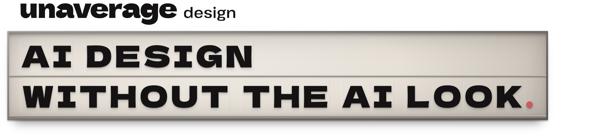

<picture>
  <source media="(prefers-color-scheme: dark)" srcset="docs/images/readme-header-dark.png">
  
</picture>

# unaverage design: AI design without the AI look

Design skill for Claude, Claude Code and Codex that aims for studio-level results instead of the generic AI look, across websites, product UI, decks, social posts, ads and brand. Built and tested in Claude Code; it also runs in the Claude app and in Codex. This repository is the marketplace of the unaverage skills; `unaverage-design` is its first skill.

English | [Deutsch](README.de.md)

A skill is a folder of instructions, reference files and small scripts that your coding agent loads when a task needs it.

```sh
npx skills add jakob-meyer/unaverage --skill unaverage-design -g -a claude-code -a codex
```

Then describe a visual task, or call `/unaverage-design` in Claude Code or `$unaverage-design` in Codex. Other install paths: [Install](#install).


<sub>Test result, not client work: the company is made up. Built with unaverage-design 3.4.2 and Claude Opus 5.5 in a run with a simulated user. The plates by Étienne Trouvelot and a NASA photograph came with the brief; no generated images. [Credits](docs/images/credits.md).</sub>

## The problem

Generic AI design is not bad taste. It is the statistical average: the same fonts, gradients, card grids and hero sections, because they are the most likely output. Strong design work differs mainly in one point: every defining element can be traced back to the subject (the product, the name, the material, the data, the people), and one idea carries the whole piece while the underlying structure stays familiar.

unaverage-design turns that into a workflow with you in the loop: understand the brief, agree on the effort, ask for things from your world, show ranked directions as mockups, build in the target medium, measure, have AI subagents review it in a fresh context, deliver the best version. For small tasks it stays as light as a craft check.

## How it works

- **One tangible idea from the product's world.** The skill looks for one visual idea for every piece, taken from an object, a situation or a concrete example in the product's world, such as the roast log of a coffee roaster or the waybill of a freight forwarder. One concrete example runs through all surfaces. Abstract shapes and pure typography support the idea; they do not replace it.
- **Your things first.** When the direction is open, the goal is clear and you have not yet named things the look should draw on, the first message asks instead of proposing: what your customers hold or look at, one or two things you love the look of from anywhere, what you can no longer stand to see in your field, what you tell someone who hesitates, and what must not be promised or must be said. Questions about things and trade-off pairs come without a suggested answer, so your words stay your own. An unclear goal adds up to three goal questions. A small task starts at once, with at most two questions, and a direction you give yourself is translated into the work, not renegotiated.
- **Three directions, ranked.** The directions follow from your answers and arrive as mockups. If you already named at least two things the look should draw on and the goal is clear, or you ask for directions at once, the three directions come in the first message instead. Either way they sit at three distances: close to the category (at its best, never the generic default), at the edge of the familiar, and bold. Each one gets a name taken from your project, what you will see, why it fits you, and the risk. The recommendation comes first, with its reasons, and you can always bring your own idea in one sentence. The directions come from a catalog of 13 style directions and are ranked for your medium, goal, audience, material and brand. A direction that needs material you do not have is never recommended, and you are told what would bring it back up.
- **Effort levels you agree on first.** Quick, Standard or Studio, stated like a quote: directions and mockups, reviewers, rounds, rough duration. The skill stays within it and names anything extra before doing it.
- **Mockups to choose from.** In Standard and Studio you get the same key surface in each direction, with the same content and the same maturity, shown side by side. The mockups differ on at least two of five levels (anchor, type voice, density, color strategy, signature moment), not only in color, and at least one shows a thing you named, if you named one. You pick one, mix along system levels, ask for safer or bolder, or bring your own idea. If the skill asked first, a trade-off question such as "what would be worse, too calm or too loud?" comes with the mockups, where you can see what it means.
- **Built in the target medium.** Pages, product screens, slides, posts, documents and logos are built as HTML, CSS and SVG at the real size of the medium and rendered as images. Every round is saved, and the version rated strongest is delivered, not the last one. Any fix made after the last review is named as unreviewed.
- **Measured and reviewed by fresh AI agents.** After each render, blocking gates check WCAG 2.2 AA contrast, horizontal overflow at 320 px, minimum font size per medium, export sizes and truth (nothing invented presented as real). AI subagents in a fresh context, playing an art director and a member of the target audience, then judge the images against a one-page design contract. In the tests they ran on the same model as the builder. They see no code and none of its reasoning, and pairwise comparisons always run in both orders.
- **Generic check.** A script renders the result and counts signatures of generic AI design, for example icon-library icons used as imagery, gradient text, colored glows, card grids and template font stacks. A generic element is replaced by something from the product's world that does the same job, not just deleted. The index measures closeness to templates, not originality, so visual review stays mandatory.
- **Honest content.** No invented facts presented as real: numbers, customers, logos, quotes or people. Sample figures can appear, for example a sample price quote in a pricing section, and are labeled as made up. Product interfaces are built from the features in your brief, with consistent sample data. Missing material gets an honest stand-in or a designed slot in the shape of the finished content. The presentation view stays clean; a separate open-items list names stand-ins, draft copy and open points.

What the German tests taught: rules and checks alone make results clean but empty. What worked against the skill's own older versions was idea and material first, then the system, then the filters. The English tests show that this order alone is not enough; see [Test results](#test-results).

Besides building, the skill has three modes: **Correction** improves an existing design and keeps its direction, with a before and after. **Review only** answers questions like "does this look generic?" with a measured quick check and three concrete changes, without building anything. **Autonomous** ("just do it") decides on its own up to Standard and lists every assumption at the end.

## Formats

| Area | Formats |
|---|---|
| Web and stores | websites, landing pages (B2B, B2C, online shop), pricing pages, campaign microsites, app store screenshots, marketplace listings |
| Product UI | web apps, dashboards, mobile apps, onboarding, states (empty, loading, error, success, overflow), settings, forms and checkout, design systems, AI chat and agent interfaces, docs and changelogs |
| Decks and documents | pitch decks, investor updates, sales decks, internal presentations, proposals, keynotes, one-pagers, reports, white papers, case studies, infographics, newsletters, transactional emails |
| Social and ads | social posts (B2B and B2C), carousels and LinkedIn documents, LinkedIn, Meta and display ads, YouTube thumbnails, TikTok and reel covers, blog headers and OG images, webinar and event visuals, share cards |
| Brand | logos and wordmarks, a first brand identity, brand refreshes, employer branding, stationery, launch kits, press kits, template kits for others |
| Print and space | flyers, posters and outdoor ads, business cards, packaging, merch, trade fair booths and roll-ups |

Each format has a profile with sizes, safe areas, minimum font size, the typical AI mistake and a starting set of directions. Localized variants for several languages or markets are covered as a case of their own.

In the German predecessor line (9 and 10 October 2026, Claude Opus 5.5), seven of these formats and the correction mode were tested blind. Version 3.4.0 was measured on two landing pages and one web app, plus one sales deck as a harm check (30 and 31 October 2026, Claude Opus 5.5). Social posts, carousels and brand work were never measured with 3.4 in a scored round; their numbers come from versions 3.0 to 3.2. The other formats use the same workflow and their profiles but were not tested on their own. See [Test results](#test-results).

Your brand comes first: brand, CI and format skills take precedence for colors, fonts and logo, and unaverage-design then works through anchor, composition, imagery, density and copy. Export formats such as PowerPoint files are the job of a format skill.

## Languages

The skill is written in English and works in English and German. The result follows the language of your brief, and the skill asks its questions in the language you write in.

Market-specific rules live in modules in `references/markets/`. The German market module covers German copy (formal or informal address, anglicisms), typography (compounds, line breaks, quotation marks, Swiss spelling, number formats) and German word lists for the generic check. A second module holds checklists for EU and DACH law: the German accessibility act (BFSG), price indication (PAngV), unfair competition (UWG), imprint, fonts and GDPR. More markets are welcome; open an issue or a pull request.

## A session, briefly

You ask for a landing page for a coffee subscription and name nothing the look should draw on. The skill reads your project folder first and then sends one bundled message (shortened, illustrative):

```text
Understood: a landing page for your coffee subscription, for people who brew
at home. Goal: subscriptions.

Effort: Standard (recommended). Three directions as mockups of the hero, two
AI reviewers, up to two fix rounds, about 30 to 60 minutes.

Five short questions before I suggest directions, because your answers shape
them. A few words are enough, and "don't know" is a fine answer.
1. What do your customers hold or look at around a delivery today, for
   example a card, a label or a note in the box?
2. Name one or two things you love the look of, from anywhere, not only
   websites.
3. What can you no longer stand to see in your field?
4. What do you tell a customer who hesitates, in your own words?
5. What must I not promise or show, and what must be said?

I assume, correct me if it is wrong: you roast yourselves and log every
batch, no photos yet, color from your world, and I build the images.
```

You answer in a few words: every bag carries a stamped roast card, and you love old pharmacy labels. Every thing you name goes into the ranking. Without answers the directions come from the brief and your trade, and the skill says so. The next message brings three mockups of the same hero side by side, ranked (shortened, illustrative):

```text
A The roast card, recommended. Edge of the familiar.
  You see: the stamped card as the hero, each coffee's roast curve on it,
  kraft brown with one roast red.
  Asks of you: a scan of one card.
B At the counter. Close to the category.
  You see: people brewing at home in daylight, soft shapes.
  Asks of you: real photos; with them, this moves up.
C The pharmacy shelf. Bold.
  You see: each coffee as a jar with an engraved label, on one long shelf.
  Asks of you: that the page reads more like a shelf than like a shop.

From your answers: the roast card carries A, the pharmacy label carries C.

What would be worse: too cold or too cozy? Without an answer the dose stays
medium.

Choose one, combine, say "none, safer" or "none, bolder", or bring your own
idea.
```

If you already named at least two things the look should draw on and the goal is clear, or you ask for directions at once, the three directions come in the first message instead.

Then:

1. You pick one, mix, or ask for safer or bolder.
2. The skill builds the page, renders it at 1440, 768, 390 and 320 px, and runs the gates and the generic check after each render.
3. Two AI subagents, playing an art director and a target-audience reviewer, judge the images in a fresh context. Every important finding is fixed or explained, in at most two rounds.
4. You get the page, what was checked with its results and what stayed unchecked, image and font sources with licenses, and an open-items list with stand-ins, draft copy and open points.

## Get the best results

It works from a single line. It gets clearly better the more of your own you bring in:

- **Answer the first questions.** Name things, not styles: what your customers hold, something you love the look of, what you can no longer stand to see in your field. "Don't know" is a fine answer.
- **Send your own material.** Photos of your place, product or team, screenshots, real figures. Phone photos are fine. Only you have them, and they show what you actually offer.
- **React to the mockups.** Say what you see first, what bothers you and what is missing. Mix two directions, or ask for safer or bolder.
- **Ask for another round** when something is still off. The skill tells you what it costs.

Without answers it still builds, from your brief and your field, and says so.

## Effort levels

| | Quick | Standard | Studio |
|---|---|---|---|
| Meant for | a single piece with a short life, brand and content fixed | website, campaign, UI, document; direction open or partly open | identity, high-stakes pitch, new product UI, brand without guidelines |
| Questions | 0 to 2 | 3 to 5 | 5 to 8, plus discovery |
| Directions you see | 1, with its reasoning in the summary | 3 mockups with the ranking (top 3 in the first message if you named things and the goal is clear, or ask for them) | 3 to 4 mockups with the ranking (top 3 in the first message if you named things and the goal is clear, or ask for them), two elaborations of the key piece compared blind |
| Reviewers | short art director check (if subagents are available) | art director, target audience | art director, target audience, generic, production and access |
| Reviewer calls, at most | 1 | 3 | 10 |
| Rounds | 1 correction | up to 2 | up to 2 per stage |
| Rough duration | 5 to 15 minutes | 30 to 60 minutes | 1.5 to 3 hours |

Durations are the skill's own estimates, not measurements. In round 3.4 Standard builds took about 1.5 to 2 hours on one laptop, with a simulated user answering at once, so treat them as a lower bound. If you say nothing, Standard applies; Studio needs an explicit yes. Words like "quick" pick Quick, "directions to choose from" or "variants" at least Standard. With a direction you give yourself there are no direction mockups.

## Install

One skill for English and German, so there is no language to choose.

With the `skills` CLI (needs Node 22.20 or newer):

```sh
# Claude Code and Codex, for all projects
npx skills add jakob-meyer/unaverage --skill unaverage-design -g -a claude-code -a codex

# only for the current project
npx skills add jakob-meyer/unaverage --skill unaverage-design -a claude-code -a codex
```

`npx skills add jakob-meyer/unaverage --skill unaverage-design` without `-a` asks which agents.

As a Claude Code plugin, inside a session:

```text
/plugin marketplace add jakob-meyer/unaverage
/plugin install unaverage-design@unaverage
```

From the shell: `claude plugin marketplace add jakob-meyer/unaverage`, then `claude plugin install unaverage-design@unaverage`.

Manually: download `unaverage-design-<version>.zip` from the [releases page](https://github.com/jakob-meyer/unaverage/releases) and unzip it.

```sh
unzip unaverage-design-<version>.zip -d ~/.claude/skills/   # Claude Code
unzip unaverage-design-<version>.zip -d ~/.agents/skills/   # Codex
```

For a single project, unzip into `.claude/skills/` or `.agents/skills/` inside the project.

In the Claude app: download `unaverage-design-<version>.zip` from the [latest release](https://github.com/jakob-meyer/unaverage/releases/latest), turn on code execution (Settings, Capabilities, Create and edit files) and upload the ZIP as a skill, as described in [Anthropic's help center](https://support.claude.com/en/articles/12512180-using-skills-in-claude). In a chat without a project folder, name the skill in your request, for example "Use the unaverage-design skill for this: ...".

### Using it

Describe the task, and the agent loads the skill when something visual is being made or reviewed. To call it directly:

| Installed with | Claude Code | Codex |
|---|---|---|
| `skills` CLI or ZIP | `/unaverage-design` | `$unaverage-design` |
| Claude Code plugin | `/unaverage-design:unaverage-design` | |

Codex reads skills from `~/.agents/skills/` and usually detects new ones by itself; otherwise restart it. The older location `~/.codex/skills/` still works but is deprecated. In the ChatGPT app it runs in Work mode once it is installed for Codex (`-a codex` above).

### Update and remove

- `skills` CLI: `npx skills update unaverage-design` and `npx skills remove unaverage-design`, with `-g` for a global install.
- Claude Code plugin: `claude plugin update unaverage-design@unaverage`, or turn on auto-update under `/plugin`, Marketplaces (it is off by default for marketplaces outside Anthropic). Remove with `claude plugin uninstall unaverage-design@unaverage`; `claude plugin marketplace remove unaverage` also removes the marketplace.
- Manual: replace or delete the folder.

The `skills` CLI ([vercel-labs/skills](https://github.com/vercel-labs/skills)) is a third-party tool. It sends anonymous usage data; set `DISABLE_TELEMETRY=1` to turn that off, for example:

```sh
DISABLE_TELEMETRY=1 npx skills add jakob-meyer/unaverage --skill unaverage-design -g -a claude-code -a codex
```

## Requirements

unaverage-design is written to work without extra tools; that path was only partly tested. For rendering, measuring and the automated generic check it uses Node 22.12 or newer, a local Chrome, Chromium, Edge or Brave, and Python 3 with Pillow and NumPy. The app you run the agent in has to find Node: on Windows a Node on the system PATH worked, while fnm without an installed Node version and without shell setup gave the agent none. After installing Node, restart that app. On first use, and again after `npx skills update`, which replaces the skill folder, the skill tells your agent to offer `npm install` in the skill folder and to run it only with your OK; this installs `puppeteer-core` and its dependencies (25 packages in the lockfile), no browser. Recent versions of Claude Code install `puppeteer-core` by themselves when they install or update the plugin (tested with 2.1.317); with older versions the instruction above applies. The browser is found in the usual places, otherwise set `CHROME_PATH`. An optional cutout tool needs macOS 14 or newer with `swiftc`.

The scripts read local files and drive a local browser; in the Claude app both are in the app's cloud workspace. They go online only when you render a URL, when a page loads web fonts or other remote resources, or for the optional font check.

unaverage-design has no vendor server and no telemetry; it runs fully local, except in the Claude app, where it runs in the app's own cloud workspace. The third-party `skills` CLI is a separate tool, see [Update and remove](#update-and-remove).

| Your setup | What you get |
|---|---|
| Shell, Node, Chrome, Python and subagents | the full workflow with measurement and independent reviewers |
| No subagents | reviewers replaced by a separate fresh run, by guided questions to you, or by a cold self-review that is named as the weakest signal |
| Single tools missing (Node, Chrome, Python) | the skill is written to say what is missing and what that costs, offer the install command (run only with your OK) or a substitute such as rendering with what your environment offers and the generic check as a visual review, and list every check that did not run in the final report; this path was only partly tested |
| No shell, for example a chat without code execution | no measurement, mockups side by side in one artifact, results marked as not verified on the image |

With version 3.4.3 at Quick, the agents in the tests of 16 November 2026 often named missing tools and `npm install` only in the final report instead of before building, or not at all, and in one Quick run in the Claude app the agent ran `npm install` in the app's cloud workspace without asking. Since 3.4.4 the skill asks about a missing tool before it builds at Quick too: in a probe in Claude Code on 20 November 2026 it did so in both runs without the tool, and in the run that went on it ran `npm install` only after the OK (not judged).

unaverage-design holds a dialog with you and uses independent reviewers, so it needs more time and tokens per result than skills that build in one pass. In the one English test round that ran both levels (version 3.0, Claude Opus 5.5, 16 October 2026), a Studio run used about twice the tokens of a Standard run.

Built and tested in Claude Code: all measured skill runs used Claude Opus 5.5, and GPT-6.1-Sol served only as a judge in them. In Codex on macOS the skill ran twice on 14 November 2026 (version 3.4.3, GPT-6.1-Sol, Quick, a poster and a social post, not judged): it loaded from `.agents/skills`, triggered once without being named, built both results and listed the checks that did not run. In Codex's default sandbox Chrome does not start, so rendering and the measured generic check need your permission to run outside the sandbox (not yet tested with 3.4.3).

On Windows 11 the skill ran on 16 November 2026 (version 3.4.3, Quick, one social post each, not judged) in Claude Code in the desktop app (Claude Opus 5.5) and in the ChatGPT app working locally with its Codex runtime (GPT-6.1-Sol), installed from the release ZIP into `~/.claude/skills` and `~/.agents/skills`. In both it triggered without being named and built the post. After `npm install`, which ran in a second round on request, both agents ran the generic check and the measuring script; called directly in PowerShell, the scripts also rendered a page and exported a PDF with Node 26.13.1 and Chrome. Windows had no Python installed: in Claude Code the generic check reported its pixel check as not run, while ChatGPT used the Python of its own runtime.

In the Claude app (desktop app on macOS, Claude Opus 5.5) the release ZIP was uploaded as a skill on 16 November 2026 (version 3.4.3, not judged). Its scripts ran in the app's cloud workspace, which had Node, Chrome and Python but could not reach Google Fonts, so the font check did not run. In a chat with a project folder the skill triggered by itself and ran Standard for a website, with three directions as mockups, the build and two independent reviewers. In a chat without a project folder it triggered only when named, and at Quick it built a poster but skipped its reviewer and its measuring script.

In the ChatGPT app on macOS the same day, with the skill added as a private plugin, Work mode (GPT-6.1-Sol) triggered it without being named and built an A4 poster as a PDF with Python, without the skill's scripts. In Chat mode (GPT-6) the app generated an image instead, even with the skill named, so the skill does not work there. In Codex and ChatGPT it often builds without its measurement scripts. None of these runs was judged, and none says anything about quality.

The skill keeps a direction log per brand as `design-log.json` in your project folder and, if writable, in `~/.unaverage/`. It keeps a brand consistent across sessions and rotates styles across brands.

## Test results

unaverage-design was developed against blind tests. AI agents built, played the users (in one test the author answered himself) and judged; no human judge and no real user stands behind these numbers. This is the short version; method, the numbers and the limits are in [docs/testing.md](docs/testing.md).

**Current version.** unaverage-design 3.4 asks first and shows directions afterwards. In a round on 30 and 31 October 2026 (tested version 3.4.0), it met a rule fixed in advance against its own predecessor, on three web and product briefs: a meal planner web app (EN6), a heat pump installer's landing page (EN7) and a barbershop landing page (EN9). One run per brief, a simulated user, three AI jury models (two Claude models and GPT-6.1-Sol). The measured change was +0.52 points on a ten-point scale, with at least +0.36 required. Most of it comes from one brief: the barbershop carries 74 percent, and without it the change is +0.20. The two versions never met in one pair; [docs/testing.md](docs/testing.md) explains how the change was measured. On one sales deck (EN10) the round showed no large harm, and nothing more than that.

**Claude without a skill.** In the fair comparison of 30 and 31 October 2026 (three AI jury models, simulated users), Claude Opus 5.5 without a skill, given the same background up front, was ahead on three of four briefs, and we do not claim to beat it; the numbers are in [docs/testing.md](docs/testing.md). Both sides had the simulated user's facts there, Opus 5.5 in its prompt and the skill through its questions, so the comparison measured the pages, not the value of asking. Even with the full background before it formed directions, the skill stayed behind ([docs/testing.md](docs/testing.md), section 2.9), and Opus 5.5's web pages passed the generic check too. In a test from one line on 7 November 2026 (version 3.4.3), where the author answered the questions as the owner of a made-up hair salon, the skill's page came out the least generic of three: generic index 0, against 5 for Claude alone and 3 for Claude alone given the same answers as text, without the author's pick among the mockups and the layout feedback. Two blind AI jury models, both Claude models, ranked it least like default AI in all four rankings. The skill runs the same check while it builds, and one run per path is one example ([docs/testing.md](docs/testing.md), section 2.13).

**Blind pairs on the AI look.** On 16 November 2026 three AI jury models, Claude Opus 5.5, Claude Fable 5.1 and GPT-6.1-Sol, compared six pairs of existing results, each with one result made with the skill and one by Claude Opus 5.5 without it for the same task, and named the one that looks more like generic AI design. They named the result without the skill in 10 of 18 verdicts and the skill's result in 8. By the rule fixed in advance for two jury models, the 7 to 5 of the two Claude models, which judged first, is undecided, and so are all 18 verdicts with the rule scaled to them; with Claude Fable 5.1 and GPT-6.1-Sol as the pair (6 to 6) the rule would read refuted. Six tasks, one run per side, only one pair with 3.4.3, no human judge, and whether the two Claude models judged blind is not recorded ([docs/testing.md](docs/testing.md), section 2.14).

**Language test.** On 16 October 2026, version 3.0 with its German market module passed the language test against the frozen German version 2.5.2 on three German briefs, narrowly on the carousel; no German build with 3.4 has been measured.

**German predecessor line.** These results come from the German predecessor of this skill, called design-craft before the release (versions 2.3 to 2.5), on German briefs with German-speaking simulated users, on 9 and 10 October 2026. They are the history of the skill, not results of the current version.

- **Against its predecessor v1** (version 1.2, not part of this repository), on eight briefs (seven formats plus the correction mode), last tested version per brief: no loss, six wins, two ties. Five of the six wins held for both judges in both presentation orders; the landing page won with the target-audience judge and split with the creative director.
- **On three briefs never used while building the skill:** two wins, one tie.
- **Distinctiveness** was higher than v1 on all eight briefs, and the AI look was equal or lower on all eight. v1 was still clearer on four of them.

Judges saw only the rendered images and the brief, without knowing which version made which result: a creative director and a member of the target audience, each in both presentation orders, plus a separate judge for the AI look.

**Generic check.** Measured three times; each measurement applies to the script of its date. The calibration of 8 October 2026 covers only web pages at 1440 x 900 (hand-picked human sites, mostly top references and award winners; 36 pages from AI site builders, plus two deliberately generic test pages): none of 68 human-designed sites reached index 3 or more, and 2 of them (3 %) missed the gate. Of 38 AI-generated pages, 25 (66 %) reached index 3 or more and 31 (82 %) missed the gate. Area under the ROC curve 0.93, against 0.80 for the previous version of the check. The repeat of 16 October 2026 gave 0.92 for both the English and the German script, the last measured area: live pages had changed, one human page now reached index 3, and three missed the gate. On 30 October 2026 the tool fixes of 3.3.1 changed no index on 128 pages; later script fixes were checked on a smaller set. Passing the check is no sign of distinctive work.

**Limits.** Most comparisons rest on one run per brief, at most two. When the same version was judged against itself (23 October 2026, three AI jury models), run 1 and run 2 differed by 0.36 points on average over four pairs and by 0.72 on the widest pair, so a single pair decides nothing. The numbers for 3.4 apply to version 3.4.0. Versions 3.4.1 to 3.4.4 add corrections whose effect on builds is unmeasured. The simulated user had a ready list of likes, and no build run with thin answers exists. On decks the result carries only "no large harm". Social posts, carousels and brand work were never measured with 3.4 in a scored round, and real use is unmeasured. All measured builds and simulated users ran on Claude Opus 5.5, and so did the skill's reviewers except in the one-line test of 7 November 2026 (Claude Sonnet 5.5); two of the three jury models are Claude models, and that test had only those two. There were no human judges and no market test. Briefs, personas and judge prompts come from the same project as the skill.

In the German line (9 and 10 October 2026) there was one run per brief and iteration, all roles ran on one model, and the tests never delivered real photos, logos or screenshots. The same v1 results, judged again in later iterations against a different partner, moved by 0 to 0.7 points from one round to the next (median 0.2) and by up to 0.8 overall. Read gaps under about half a point as ties; a win counts only if it holds in both presentation orders. Versions 2.5.1 and 2.5.2 were not tested on their own.

## Repository layout

| Path | Content |
|---|---|
| [`skills/unaverage-design/`](skills/unaverage-design/) | the skill |
| [`.claude-plugin/marketplace.json`](.claude-plugin/marketplace.json) | Claude Code plugin marketplace with one plugin |
| [`docs/testing.md`](docs/testing.md) | test method, results and limits |
| [`docs/images/`](docs/images/) | the README header and images from the test runs, with [credits](docs/images/credits.md) |
| [`CHANGELOG.md`](CHANGELOG.md) | changes |
| [`NOTICE.md`](NOTICE.md) | origin, third-party software, images, legal notes |
| [`LICENSE`](LICENSE) | Apache License 2.0 |

The skill folder is complete on its own, because every install path copies only that folder:

| In the skill folder | Content |
|---|---|
| `SKILL.md` | the workflow; the agent reads it first and loads references only when a stage needs them |
| `references/` | format profiles, the 13 style directions and their modules, creative method, craft, fonts, images and assets, review, generic catalog, accessibility and law, each with sources |
| `references/markets/` | market modules: German copy and typography, EU and DACH law |
| `templates/` | design contract, review brief, credits, direction log, deck shell |
| `scripts/` | rendering, PDF export, measuring, generic check, font check, contact sheets and color analysis, cutouts, shadows, perspective, labels for AI-generated images |
| `assets/doodles/` | accents in a hand-drawn style (SVG), made for this skill |
| `agents/openai.yaml` | display name and default prompt for Codex |
| `LICENSE`, `NOTICE.md` | license and origin, so every install carries them |

## Not for

- **Videos.** unaverage-design makes still images and screens. Use a video skill for motion.
- **Pure text** without visual design.
- **Legal advice.** The skill flags mandatory items as placeholders and asks, instead of writing legal texts. Its notes on law and accessibility are checklists, current as of October 2026.
- **Market tests.** Reviewer judgments are AI judgments. For ads and social posts the skill adds a test plan and says that reviewer judgments do not replace a market test.

It also does not present invented metrics, testimonials, customer logos, ratings or people as real, does not copy specific designs or imitate living artists or studios, generates images only after your explicit approval, and publishes, buys or uploads nothing without your approval.

## Feedback

Please open an [issue](https://github.com/jakob-meyer/unaverage/issues). Most helpful: the brief (shortened is fine), the effort level, agent and model, version, the language of the brief, what you expected, and the result as an image. Leave out confidential brand material.

When you correct the skill beyond a single case, it collects that at the end of a session and suggests changes to itself, changing nothing without your consent. Those suggestions are welcome as issues too.

## License

Apache License 2.0, see [LICENSE](LICENSE). Origin, third-party software and notes on images are in [NOTICE.md](NOTICE.md). Fonts are not included; the font catalog lists freely licensed typefaces with license and source.

Claude and Claude Code are products of Anthropic; Codex, ChatGPT and GPT are products of OpenAI. This project is independent and not affiliated with either.

## Author

Jakob Meyer

[Jakob Meyer on LinkedIn](https://www.linkedin.com/in/jakob-leon-meyer)
